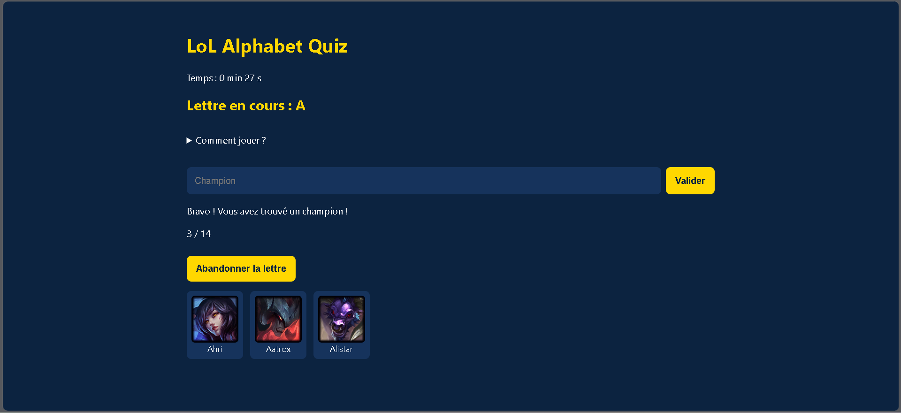
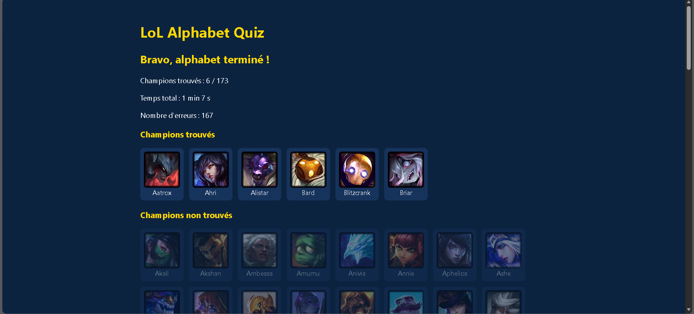
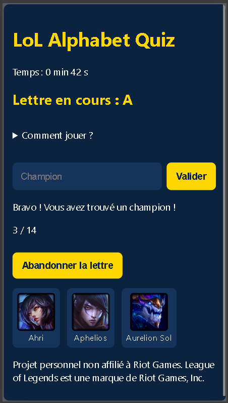

# LoL Alphabet Quiz

Un jeu web où il faut deviner **tous les champions de League of Legends, lettre par lettre**, dans l'ordre alphabétique.

🎮 **Jouer en ligne : [https://eda31.github.io/lol-alphabet-quiz/](https://eda31.github.io/lol-alphabet-quiz/)**

## Aperçu







> 🚧 Projet en cours de développement, réalisé dans le cadre de mon portfolio.

## Comment jouer

1. Une lettre est affichée (en commençant par A).
2. Tape le nom d'un champion dont le nom commence par cette lettre, puis valide avec Entrée ou le bouton « Valider ».
3. Les majuscules, les accents et les apostrophes sont ignorés : « kaisa » est accepté pour Kai'Sa.
4. Quand tous les champions de la lettre sont trouvés, un bouton permet de passer à la lettre suivante.
5. Un champion reste introuvable ? Le bouton « Abandonner la lettre » termine le tour, et les champions manqués comptent comme des erreurs.
6. À la fin de l'alphabet, un écran de résultats affiche le temps total, les erreurs et la liste des champions trouvés et manqués.

## Fonctionnalités

- [x] Structure du projet en architecture MVC
- [x] Chargement des champions depuis l'API Data Dragon (toujours la dernière version du jeu)
- [x] Normalisation des noms (accents, apostrophes, casse)
- [x] Saisie et vérification des réponses
- [x] Affichage des icônes et compteur par lettre
- [x] Gestion des tours (A → Z)
- [x] Statistiques de partie : temps par lettre, erreurs, champions trouvés
- [x] Écran de fin avec résultats triés par ordre alphabétique
- [x] Chronomètre en direct et bouton « Abandonner la lettre »
- [x] Design responsive (utilisable sur téléphone)
- [x] Déploiement en ligne avec GitHub Pages
- [ ] Back-end Symfony : API, base de données, scores et classement

## Compétences mises en pratique

- **Architecture MVC** en JavaScript pur, sans framework : séparation des données, de l'affichage et de la logique de jeu
- **Programmation asynchrone** : appels à une API avec `fetch` et `async/await`
- **Manipulation du DOM** : création d'éléments, écouteurs d'événements, gestion d'état de l'interface
- **Traitement de texte** : normalisation des accents et des caractères spéciaux (`normalize("NFD")` et expressions régulières)
- **Design responsive** : flexbox, variables CSS, media queries
- **Méthode de travail** : issues et tableau Kanban, une branche par fonctionnalité, pull requests
- **Déploiement** : publication avec GitHub Pages

## Technologies

**Actuellement**
- HTML5, CSS3 (variables, flexbox, media queries)
- JavaScript (modules ES6, `async/await`, `fetch`)
- Architecture MVC
- API Data Dragon de Riot Games
- Git et GitHub : branches, issues, pull requests, tableau Kanban
- GitHub Pages pour l'hébergement

**Prévues**
- PHP / Symfony pour une API REST
- Base de données pour les scores et le classement

## Architecture

Le projet suit le modèle **MVC** (Modèle, Vue, Contrôleur) :

- **Modèle** : gère les données (liste des champions, état d'une lettre, statistiques de la partie).
- **Vue** : s'occupe uniquement de l'affichage.
- **Contrôleur** : fait le lien entre le modèle et la vue, et contient le déroulement du jeu.

```
lol-alphabet-quiz/
├── index.html
├── css/
│   └── style.css
├── js/
│   ├── main.js
│   ├── models/
│   │   ├── ChampionModel.js
│   │   ├── GameModel.js
│   │   └── GameStats.js
│   ├── views/
│   │   └── GameView.js
│   ├── controllers/
│   │   └── GameController.js
│   └── utils/
│       └── Normalize.js
└── README.md
```

## Base de données

Aucune base de données pour le moment : les données des champions sont récupérées en direct depuis Data Dragon. Une base sera ajoutée avec le back-end Symfony pour enregistrer les scores et afficher un classement.

## Installation et lancement en local

1. Cloner le dépôt :
   ```
   git clone https://github.com/Eda31/lol-alphabet-quiz.git
   ```
2. Ouvrir le dossier dans Visual Studio Code.
3. Installer l'extension **Live Server**.
4. Faire un clic droit sur `index.html`, puis **Open with Live Server**.

> Le projet utilise des modules JavaScript : il doit être lancé via un serveur local (comme Live Server). Ouvrir `index.html` par double-clic ne fonctionnera pas.

## Source des données

Les noms et les images des champions proviennent de [Data Dragon](https://developer.riotgames.com/docs/lol#data-dragon), les données statiques publiques de Riot Games.

## Pistes d'amélioration

- Back-end Symfony : enregistrer les scores, comptes joueurs et classement
- Sauvegarde de la partie en cours
- Mode chronométré avec une durée limite par lettre
- Tests automatisés de la logique de jeu

## Mentions légales

Ce projet n'est pas affilié à Riot Games. League of Legends et ses éléments associés sont des marques de Riot Games, Inc.

## Auteur

**Eda31** – [GitHub](https://github.com/Eda31)
