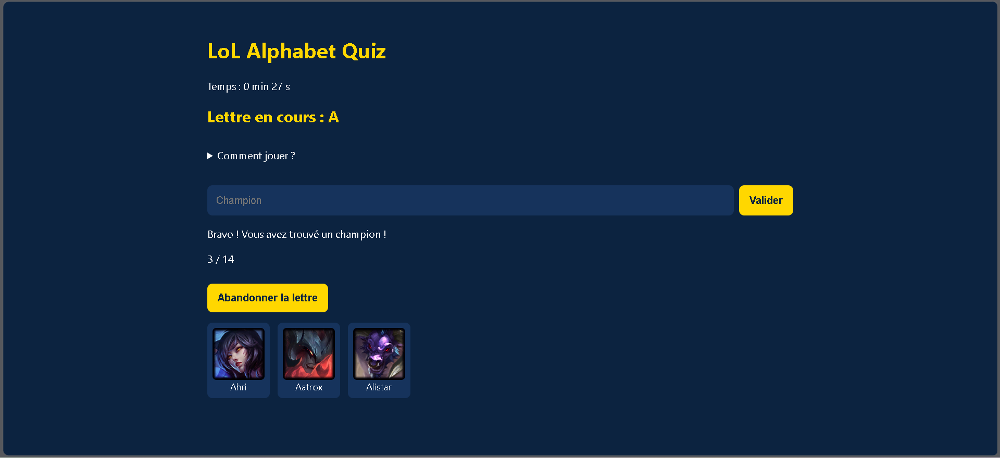
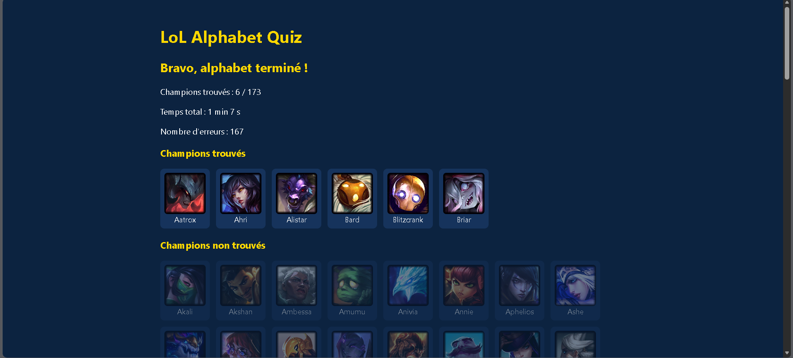
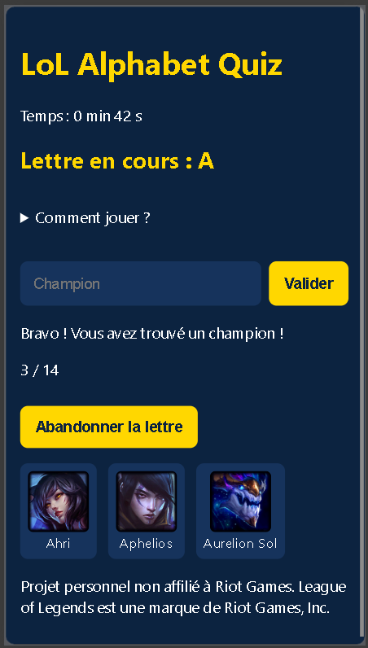

# LoL Alphabet Quiz

Un jeu web où il faut deviner **tous les champions de League of Legends, lettre par lettre**, dans l'ordre alphabétique.

🎮 **Jouer en ligne : [https://eda31.github.io/lol-alphabet-quiz/](https://eda31.github.io/lol-alphabet-quiz/)**

Projet personnel en JavaScript pur (sans framework), construit en architecture MVC et déployé avec GitHub Pages.

## Aperçu







## Comment jouer

1. Une lettre est affichée (en commençant par A).
2. Tape le nom d'un champion dont le nom commence par cette lettre, puis valide avec Entrée ou le bouton « Valider ».
3. Les majuscules, les accents et les apostrophes sont ignorés : « kaisa » est accepté pour Kai'Sa.
4. Quand tous les champions de la lettre sont trouvés, un bouton permet de passer à la lettre suivante.
5. Un champion reste introuvable ? Le bouton « Abandonner la lettre » termine le tour, et les champions manqués comptent comme des erreurs.
6. À la fin de l'alphabet, un écran de résultats affiche le temps total, les erreurs et la liste des champions trouvés et manqués.

## Fonctionnalités

- Architecture MVC
- Chargement des champions depuis l'API Data Dragon, toujours avec la dernière version du jeu
- Normalisation des saisies (accents, apostrophes, espaces, majuscules)
- Compteur et icônes des champions trouvés
- Enchaînement des 26 lettres, de A à Z
- Statistiques de partie : temps par lettre, erreurs, champions trouvés
- Chronomètre en direct qui ne démarre qu'à la première saisie de chaque lettre
- Bouton « Abandonner la lettre »
- Écran de fin avec résultats triés par ordre alphabétique
- Design responsive, utilisable sur téléphone

## Choix techniques

- **Pas de framework, pas de build** : tout est en JavaScript standard (modules ES6). Le site est un ensemble de fichiers statiques, donc hébergeable gratuitement.
- **Une logique de normalisation unique** : le nom saisi et le nom du champion passent par la même fonction avant d'être comparés. Ainsi « kaisa », « Kai'Sa » et « KAI SA » sont équivalents, et « Maître Yi » s'écrit « maitre yi ».
- **Un modèle de jeu par lettre** : `GameModel` ne gère qu'une seule lettre et est recréé à chaque tour. Les données qui durent toute la partie (temps, erreurs, champions trouvés) sont dans un modèle séparé, `GameStats`.
- **La vue ne contient aucune logique** : elle affiche uniquement ce que le contrôleur lui demande. Les règles du jeu sont dans les modèles et le déroulement dans le contrôleur.
- **Pas de back-end** : le jeu n'a pas besoin de base de données. Un classement en ligne demanderait un hébergement et une gestion de la sécurité qui ne se justifiaient pas pour ce projet.

## Difficultés rencontrées

- **Les noms spéciaux** (Kai'Sa, Kha'Zix, Maître Yi, Dr. Mundo) : résolus avec `normalize("NFD")` pour séparer les accents, puis une expression régulière pour ne garder que les lettres et les chiffres.
- **L'ordre de chargement** : l'adresse des icônes dépend de la version du jeu, récupérée par une requête asynchrone. Il fallait attendre ce chargement avant de créer la vue, sinon les images pointaient vers une version `null`.
- **La casse des noms de fichiers** : en ligne, un import écrit `normalize.js` ne trouve pas un fichier nommé `Normalize.js`, alors que Windows ne fait pas la différence. J'ai appris à vérifier chaque import avant de publier.
- **L'écran de fin** : il a fallu garder l'historique des champions trouvés et manqués sur toute la partie, alors que le modèle d'une lettre est recréé à chaque tour.

## Technologies

- HTML5, CSS3 (variables, flexbox, media queries)
- JavaScript (modules ES6, `async/await`, `fetch`)
- API Data Dragon de Riot Games
- Git et GitHub (branches, issues, pull requests, tableau Kanban)
- GitHub Pages

## Compétences mises en pratique

- **Architecture MVC** en JavaScript pur : séparation des données, de l'affichage et de la logique de jeu
- **Programmation asynchrone** : appels d'API avec `fetch` et `async/await`
- **Manipulation du DOM** : création d'éléments, écouteurs d'événements, gestion de l'état de l'interface
- **Traitement de texte** : normalisation Unicode et expressions régulières
- **Design responsive** : approche mobile d'abord
- **Méthode de travail** : une branche par fonctionnalité, pull requests, suivi par issues et Kanban
- **Déploiement** : publication d'un site statique

## Architecture

```
lol-alphabet-quiz/
├── index.html
├── css/
│   └── style.css
├── docs/
│   └── screenshots/
├── js/
│   ├── main.js
│   ├── models/
│   │   ├── ChampionModel.js    (chargement des champions)
│   │   ├── GameModel.js        (état d'une lettre)
│   │   └── GameStats.js        (statistiques de la partie)
│   ├── views/
│   │   └── GameView.js         (affichage)
│   ├── controllers/
│   │   └── GameController.js   (déroulement du jeu)
│   └── utils/
│       └── Normalize.js        (normalisation des noms)
└── README.md
```

## Installation et lancement en local

1. Cloner le dépôt :
   ```
   git clone https://github.com/Eda31/lol-alphabet-quiz.git
   ```
2. Ouvrir le dossier dans Visual Studio Code.
3. Installer l'extension **Live Server**.
4. Faire un clic droit sur `index.html`, puis **Open with Live Server**.

> Le projet utilise des modules JavaScript : il doit être lancé via un serveur local (comme Live Server). Ouvrir `index.html` par double-clic ne fonctionnera pas.

## Source des données

Les noms et les images des champions proviennent de [Data Dragon](https://developer.riotgames.com/docs/lol#data-dragon), les données statiques publiques de Riot Games.

## Pistes d'amélioration

- Meilleur score enregistré dans le navigateur
- Sauvegarde de la partie en cours
- Mode chronométré avec une durée limite par lettre
- Tests automatisés de la logique de jeu
- Back-end (API, comptes, classement) si un hébergement adapté est disponible

## Mentions légales

Ce projet n'est pas affilié à Riot Games. League of Legends et ses éléments associés sont des marques de Riot Games, Inc.

## Auteur

**Eda31** – Développeuse web, diplômée du BTS SIO option SLAM

[GitHub](https://github.com/Eda31) · [Portfolio](https://monportepoliomarcailloujade.weebly.com/)
